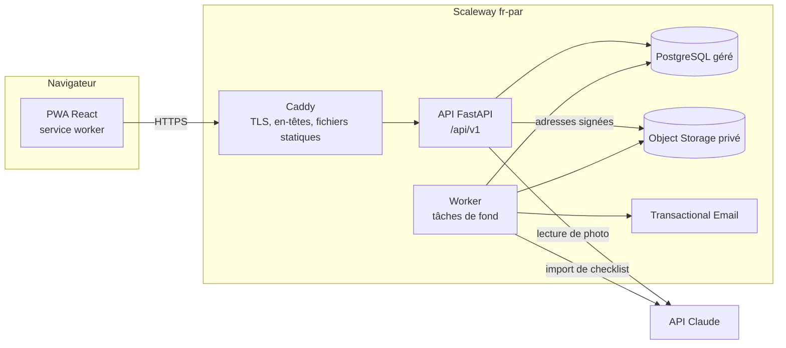

# Dossier d'architecture

Réponse au point 1 de la section 1.4 du cahier des charges (v2.0 du 15/11/2026) : pile technique,
hébergement, modèle de données, choix du modèle d'IA et coûts de fonctionnement.
Prix relevés le 16/11/2026, hors taxes.

## 1. Les choix en une page

| Sujet | Choix | Pourquoi |
|---|---|---|
| API | Python 3.13, FastAPI, SQLAlchemy 2 (mode synchrone), Alembic | Pile demandée. Le mode synchrone suffit à cette volumétrie et se débogue sans surprise ; les appels longs partent dans le worker. |
| Base | PostgreSQL 16 | Exigence T-03. Contraintes d'intégrité, recherche plein texte (GIN), file de tâches (`SKIP LOCKED`) : un seul système à sauvegarder. |
| Tâches de fond | Table `job` + un processus worker (même image) | Pas de Redis ni de Celery à exploiter. Import de checklist, export, suppression de compte, e-mails (T-05). |
| Photos | Stockage objet compatible S3, privé ; Pillow pour les trois tailles | T-04. Les images passent toujours par l'API, qui vérifie le droit d'accès avant de rediriger vers une adresse signée. |
| Interface | React 19, TypeScript, Vite, TanStack Query, CSS sans framework | Une seule base de code, PWA installable (T-01). CSS écrit à la main sur les jetons du prototype : pas d'habillage générique. |
| Contrat API ↔ interface | OpenAPI généré par FastAPI → types TypeScript générés | Le compilateur signale tout écart entre le serveur et l'écran. |
| Sessions | Jeton opaque en cookie `HttpOnly`, haché en base | Révocable, listable (F-30), rien d'exploitable par un script injecté. |
| IA | API Claude, appelée par le serveur uniquement ; Haiku 5.5 pour la lecture de photo, Sonnet 5.5 pour l'import de checklist | Voir section 5. |
| Hébergement | Scaleway, région Paris : une instance (Caddy + API + worker), PostgreSQL géré, Object Storage, Transactional Email | Tout dans l'UE chez un seul sous-traitant (T-06, D-04). Voir section 6. |

## 2. Vue d'ensemble

Trois processus tirés de la même image Docker : `api` (uvicorn), `worker` (boucle sur la table `job`),
et `migrate` (Alembic, lancé avant chaque déploiement). L'interface compilée est servie comme
fichiers statiques.

**Règles d'accès (T-02).** Chaque requête passe par une dépendance qui résout l'utilisateur ; chaque
requête SQL sur une donnée privée filtre sur `user_id`. Les vues publiques ont leur propre module
(`app/api/public.py`) et leurs propres schémas de réponse, qui ne contiennent aucun champ de prix,
de date d'achat, de plateforme ni de quantité : une donnée privée ne peut pas fuiter par oubli d'un
filtre, le champ n'existe pas dans le type renvoyé.

**API versionnée.** Tout est sous `/api/v1`. Chaque réponse porte `X-App-Version` ; quand elle
change, l'interface déjà ouverte se recharge à la prochaine navigation (leçon du prototype, 8.3).

**Enregistrement optimiste (T-08).** TanStack Query applique la modification à l'écran, garde l'état
précédent, et le restaure si l'appel échoue. Les modifications en échec restent dans une file en
mémoire ; le bandeau « Réessayer » la rejoue.

## 3. Performances visées (8.2)

| Exigence | Réponse |
|---|---|
| Collection de 5 000 cartes en moins d'1 s | Deux appels en parallèle : la checklist (tableaux compacts, ~70 Ko compressés, mise en cache par version de série) et l'état de l'utilisateur (seulement les cartes touchées). Le rendu ne monte que les sous-séries proches de l'écran. |
| Recherche en moins de 300 ms | Dans une collection : en mémoire, côté navigateur. Globale : index GIN sur des jetons normalisés, préfixe pour les mots, égalité pour les nombres. |
| 10 000 références par série | Une ligne par référence ; l'état d'un utilisateur n'existe que pour les cartes qu'il a touchées. |

## 4. Modèle de données

Le modèle suit la section 9.1. Écarts et précisions :

| Point | Choix | Raison |
|---|---|---|
| `user_card` | Rattachée à l'utilisateur et à la référence, pas à la collection | La possession survit à « Ne plus suivre » (RG-12) et les cartes isolées n'ont pas besoin d'une collection (RG-11). |
| `user_card.parallel_count` | Compteur tenu à jour par le service | « Possédée » = `quantity > 0 OR parallel_count > 0` (RG-05), sans jointure. |
| `card_ref.search_tokens` | Jetons normalisés (sans accents, minuscules, parties du code) | Mêmes règles de recherche côté serveur et côté navigateur ; vecteurs de test partagés dans `shared/`. |
| `card_ref.merged_into_id`, `status` | Masquer ou fusionner au lieu de supprimer | RG-04. |
| `series.version` | Incrémentée à chaque publication | Cache de la checklist, historique, comparaison avant publication (F-38). |
| `job` | Remplace `import_job` | Une seule table pour toutes les tâches longues, avec état et progression. |
| `checklist_import` | Brouillon JSON modifiable jusqu'à la publication | Les étapes 2 à 4 de F-36 travaillent sur le brouillon ; rien n'entre au catalogue avant validation (RG-19). |
| `session`, `auth_token` | Jetons hachés (SHA-256) | Un vol de base ne donne aucune session. |
| Montants | `numeric(10,2)` | Pas de flottants pour l'argent. |

Le schéma complet est dans `backend/app/models.py` ; les migrations dans `backend/migrations/`.

## 5. Intelligence artificielle

| Fonction | Modèle par défaut | Entrée type | Coût par appel |
|---|---|---|---|
| Lecture d'une photo (F-19) | Claude Haiku 5.5 | Photo réduite à 1 024 px (≈ 1 000 jetons) + consigne + séries candidates (≈ 2 000 jetons), sortie ≈ 80 jetons | ≈ 0,0004 $ |
| Import d'une checklist (F-36) | Claude Sonnet 5.5 | Texte du PDF découpé par rubrique ; pour 4 042 cartes ≈ 70 000 jetons en entrée, 150 000 en sortie | ≈ 1,60 $ pour la plus grosse série ; 0,30 $ en moyenne |
| Vérification d'un achat (F-40, V1.1) | Claude Sonnet 5.5 | Photo + fiche + extrait de checklist | ≈ 0,01 $ |

Tarifs utilisés (par million de jetons) : Haiku 5.5 à 0,10 $ en entrée et 0,50 $ en sortie ;
Sonnet 5.5 à 2 $ et 10 $. La même lecture de photo sur Sonnet 5.5 coûte environ 0,007 $, soit
dix-sept fois plus.

**Ce choix n'est pas mesuré.** Je n'ai ni clé d'API ni photos réelles dans cet environnement.
Haiku 5.5 est retenu par défaut parce que son coût rend possible une offre gratuite généreuse ; le
jeu d'essai IA-05 (`backend/tests/ai_eval/`) doit trancher dès que les 48 photos du prototype sont
disponibles. Le modèle se change par variable d'environnement, sans toucher au code.

Garde-fous en place :

- **IA-01** : sortie contrainte par schéma (sorties structurées de l'API), revalidée par Pydantic ;
  une réponse invalide est rejouée une fois, puis signalée. Rien n'est appliqué.
- **IA-02, RG-20** : chaque appel écrit une ligne `ai_call` (fonction, modèle, durée, jetons, coût
  estimé, résultat). Le quota (jour et mois) est vérifié avant l'appel, dans la même transaction.
- **IA-04** : toutes les fonctions d'IA ont un chemin manuel ; l'interface affiche l'état
  (indisponible, quota atteint) et laisse saisir.
- **S-05** : le texte d'un PDF et les réponses du modèle ne sont jamais interprétés comme des
  consignes ; le contenu importé est passé dans un bloc délimité, et la sortie n'est lue que comme
  données typées.
- **IA-03** : l'API Claude ne sert pas les données des clients à l'entraînement et les efface sous
  30 jours au plus. Le traitement a lieu hors de l'UE par défaut : la politique de confidentialité
  doit le dire, et le contrat de sous-traitance doit être signé. Si l'inférence doit rester dans
  l'UE, Claude est aussi proposé via des points d'accès régionaux chez AWS et Google (surcoût
  annoncé de 10 %) — à vérifier avant de s'engager.

## 6. Hébergement

**Retenu : Scaleway, région Paris.**

| Brique | Service | Remarque |
|---|---|---|
| Calcul | Une instance avec Docker Compose : Caddy, `api`, `worker` | Déploiement par GitHub Actions : construction de l'image, envoi au registre, `docker compose pull && up -d` par SSH. |
| Base | Managed Database for PostgreSQL | Sauvegardes automatiques quotidiennes. En plus : `pg_dump` chiffré (age) vers un bucket dédié, cycle de vie à 30 jours, restauration rejouée chaque mois sur la recette (T-06). |
| Photos | Object Storage, bucket privé | 0,0146 €/Go/mois ; 75 Go de sortie gratuits par mois, puis 0,01 €/Go. |
| E-mails | Transactional Email (SMTP) | 300 e-mails gratuits par mois, puis 0,25 € les 1 000. |
| Supervision | Sentry (erreurs, performances), Cockpit (métriques, journaux), sonde externe sur `/api/v1/health` | T-07. |

Trois environnements (T-07) : développement en local (`docker compose up`, stockage sur disque,
e-mails dans la console, IA simulée) ; recette sur une petite instance avec une base distincte,
sans aucune donnée réelle ; production.

**Pourquoi pas Serverless Containers ?** Le worker doit tourner sans requête entrante ; je n'ai pas
pu vérifier que le processeur reste alloué hors requête sur cette offre. Une instance est
prévisible, et l'image Docker reste portable chez n'importe quel hébergeur européen (OVHcloud,
Hetzner, Clever Cloud) : seuls l'API S3 et PostgreSQL sont supposés.

## 7. Coûts mensuels estimés

Hypothèses : la moitié des inscrits actifs dans le mois, 25 lectures de photo par actif, 120 photos
conservées par utilisateur à 0,5 Mo (les trois tailles), 3 e-mails par utilisateur et par mois.

| Poste | 100 utilisateurs | 1 000 utilisateurs | 10 000 utilisateurs |
|---|---|---|---|
| Instance(s) de production | ≈ 7 € (2 vCPU, 2 Go) | ≈ 20 € (2 vCPU, 4 Go) | ≈ 50 € (4 vCPU, 8 Go + une petite pour le worker) |
| PostgreSQL géré | 12 € (DB-DEV-S + 10 Go) | 35 € (DB-PLAY2-NANO + 30 Go) | 171 € (DB-PRO2-XXS, nœud de secours, 100 Go) |
| Sauvegardes | < 1 € | 1 € | 5 € |
| Photos (stockage + sortie) | 0,10 € (6 Go) | 0,90 € (60 Go) | 11 € (600 Go) |
| E-mails | 0 € | 0,70 € | 7,50 € |
| Recette (instance + base à l'usage) | ≈ 9 € | ≈ 9 € | ≈ 9 € |
| Supervision, nom de domaine | ≈ 1 € | ≈ 1 € | ≈ 27 € (Sentry payant) |
| **Infrastructure** | **≈ 30 €** | **≈ 68 €** | **≈ 280 €** |
| IA, lecture de photo (Haiku 5.5) | 0,50 $ | 5 $ | 50 $ |
| IA, imports de checklists (Sonnet 5.5) | 5 à 15 $ | 5 à 15 $ | 5 à 15 $ |

Les prix de la base, du stockage et des e-mails viennent de la grille Scaleway. Ceux des instances
viennent de comparateurs et sont à confirmer sur la grille au moment de la commande. La même
lecture de photo sur Sonnet 5.5 porterait la ligne IA à 9 $, 88 $ et 875 $.

Avec les quotas par défaut (10 lectures par jour, 100 par mois), un utilisateur gratuit coûte au
plus 0,04 $ d'IA par mois : le modèle économique (question ouverte) peut se décider sur le stockage
des photos plutôt que sur l'IA.

## 8. Sécurité et données personnelles

- **Mots de passe** : Argon2id. **Sessions** : cookie `HttpOnly`, `Secure`, `SameSite=Lax`.
  **CSRF** : toute requête modifiante doit venir de la même origine (en-têtes `Origin` /
  `Sec-Fetch-Site`). **Double authentification** : TOTP, obligatoire pour atteindre `/admin` (S-01).
- **Cloisonnement** : tests automatisés par ressource — l'utilisateur B reçoit 404 sur toute
  collection, carte, photo ou achat de A (S-02, CA-01).
- **Débit** : compteurs en base par clé (IP, compte) sur la connexion, l'inscription, l'envoi de
  photos et l'IA (S-04).
- **Photos** : ré-encodées à l'envoi, ce qui supprime toutes les métadonnées (RG-14, CA-04) ;
  type vérifié sur le contenu, pas sur l'extension.
- **Suppression de compte** : tâche de fond qui efface les lignes et les objets du stockage, puis
  envoie la confirmation ; les sauvegardes expirent à 30 jours (CA-16).
- **Mesure d'audience** : aucune en V1 ; pas de cookie non essentiel, donc pas de bandeau (D-05).
- **Polices** : servies par l'application, aucun appel à un tiers.

## 9. Interprétations du cahier des charges à confirmer

Le cahier des charges demande de remonter les questions plutôt que de trancher. Ces points n'y sont
pas écrits noir sur blanc ; j'ai pris l'option indiquée pour ne pas bloquer, chacune se change
facilement.

| # | Point | Option prise |
|---|---|---|
| 1 | Une carte vendue compte-t-elle encore comme possédée ? | Non. RG-02 interdit de montrer une carte vendue ; la vente retire donc l'exemplaire (ou masque le parallèle relié) et l'annulation le rend. |
| 2 | Deux achats « base » de la même carte | Le second ne change pas la quantité (RG-09 dit « cochée, quantité 1 si elle manquait »). |
| 3 | Supprimer une collection | Efface la possession de cette série ; les achats restent. « Ne plus suivre » ne perd rien (RG-12). |
| 4 | Signalement par un visiteur sans compte (F-45) | Autorisé, limité en débit. |
| 5 | Confirmation de l'âge (F-29) | Case à cocher déclarative ; aucune date de naissance n'est stockée. |
| 6 | Recherche « wk3 » | Un jeton qui contient un chiffre doit égaler un code ou sa partie numérique : « wk3 » trouve WK-3, pas WK-30. |

Questions ouvertes de la section 17 : aucune n'est tranchée dans le code. Nom du produit, éditeur
du service et adresses légales sont des variables de configuration ; les hypothèses de la
section 1.5 s'appliquent.

## 10. Ce qui n'est pas vérifiable d'ici

- Les appels réels à l'API Claude (pas de clé) : le code suit la documentation, les tests passent
  par un fournisseur simulé.
- La connexion Google et Apple (pas d'identifiants).
- La reprise des données réelles du prototype (pas d'accès) : le script est testé sur des données
  de synthèse au format de l'annexe E.
- Le déploiement chez l'hébergeur.
